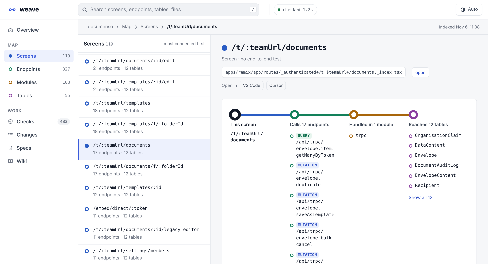
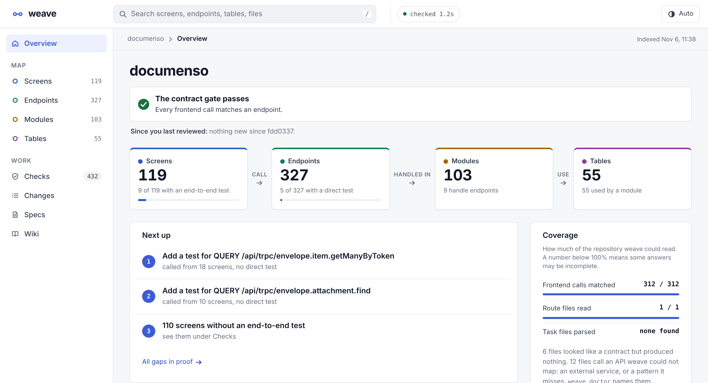

# weave

**Catch the frontend call your agent just broke, before it says "done".**

weave reads a web app's repository and maps it: which **screens** call which **endpoints**,
which **modules** handle them, which **tables** they touch. Then it holds every change to that
map. Rename a route, delete a tRPC procedure or drop a GraphQL field, and `weave check` fails
with the exact `file:line` that still calls it. It runs in a Stop hook, a pre-commit hook or a
pull-request check.

One static Go binary. No server, no account, no network.

<picture>
  <source media="(prefers-color-scheme: dark)" srcset="docs/img/screens/documenso-dark.png">
  
</picture>

<sub>documenso, a 2,458-file Remix + tRPC + Prisma monorepo, read with no configuration in under a second.</sub>

## Try it

```bash
go install github.com/michalbasisty/weave/cmd/weave@latest   # or grab a binary from Releases
cd your-app
weave check          # what the uncommitted change breaks; exit 1 if anything
weave serve          # the map in your browser, every project you use in one dropdown
weave init --hooks   # wire it into Claude Code, Cursor, VS Code, opencode, OpenChamber
```

Binaries for macOS, Linux and Windows are on
[Releases](https://github.com/michalbasisty/weave/releases).

## What it catches

Rename `GET /tags` to `/tag-list` in the RealWorld Express back end, leave the React front end alone:

```console
$ weave check
check: 1 file(s) → 1 endpoint(s), 0 page(s), 1 test(s), 1 endpoint(s) removed
  FAIL removed endpoint still called: GET /tags from frontend/src/agent.js:218 (closest now: GET /tag-list)
  warn no spec change record names these files
  warn 1 touched endpoint(s) have no direct test
  run  cd backend && npx jest src/tests/services/tag.service.test.ts
```

Exit code 1, the caller's line, the route it most likely meant, and the tests to run. Nothing in the type system sees this:
the route and its caller only share a string. In a pull request, the bundled GitHub Action
posts the same report, with the screens that lose their data:

> ### ❌ weave check: 1 problem(s)
>
> | endpoint | called from | screens |
> |---|---|---|
> | `GET /tags` | `frontend/src/agent.js:218` | `/`, `/login`, `/register`, `/editor/:slug`, `/editor` +3 |


Three things fail the gate, nothing else: a **removed endpoint that is still called**, a
**call that matches no endpoint**, and a **requirement whose test fails** (when you link
them). Untested endpoints and stale specs are warnings, because a gate that cries wolf gets
switched off in a week.

## Why not grep and read the files?

Because in a modern stack the URL is not written down anywhere. tRPC builds it from nested
router keys, Remix from file names, NestJS from two decorators and a global prefix:


And when an agent needs to understand a screen before changing it, the facts are spread over
the screen, its handlers, their tests and the models behind them. weave answers with one
call:


```console
$ weave context frontend/src/components/Home/index.js
/  frontend/src/components/Home/index.js
used by   1 file(s)
page      /, /login~, /register~, /editor/:slug~ +4
module    auth, tag, article, profile
endpoint  GET /user  auth/auth.controller.ts:45
          POST /users/login  auth/auth.controller.ts:30
          POST /users  auth/auth.controller.ts:14
          PUT /user  auth/auth.controller.ts:61
          +11 more
tables    User, Tag, Article, Comment
run
  cd backend && npx jest src/tests/services/article.service.test.ts src/tests/services/auth.service.test.ts …
tests     none for this file; 5 in its modules
untested  GET /user, POST /users/login, POST /users +12
also      /login, /register, /editor/:slug, /editor share these endpoints
~         inferred link — a lead, not a fact
```

It is quick enough to run on every agent turn:


## Measured on real repositories

| | [documenso](https://github.com/documenso/documenso) | RealWorld Express + React | [RealWorld NestJS](https://github.com/lujakob/nestjs-realworld-example-app) |
|---|---|---|---|
| stack | Remix, tRPC, Prisma monorepo | Express, Prisma, React, Redux | NestJS, TypeORM |
| screens / endpoints | 119 / 327 | 8 / 20 | — / 21 |
| frontend calls matched | **312 of 312** | **18 of 18** | — |
| screens linked to their endpoints | 87 of 119 | 8 of 8 | — |
| tables with a module that uses them | 55 of 55 | 4 of 4 | 5 of 5 |
| false failures on the unchanged repo | **0** | **0** | **0** |
| `weave check` | ~1.2 s | 47 ms | 37 ms |

The same React front end in front of Gin, Flask, Django, Rails and Laravel back ends matches
18 of 18 calls with 0 false failures on each ([details](docs/COMPARISON.md#6-python-go-ruby-and-php-back-ends)).

No configuration on any of them. Every number comes from [`bench/run.mjs`](bench/run.mjs),
which fetches these repositories at fixed commits ([`bench/fetch.sh`](bench/fetch.sh)) and
anyone can rerun. Methods and the raw results are in
[`docs/COMPARISON.md`](docs/COMPARISON.md).

## Four ways in, one index

**The gate.** `weave check` when the agent stops (`weave init --hooks` writes the
[Claude Code Stop hook](docs/REFERENCE.md#connecting-an-agent) and an opencode plugin that
OpenChamber runs too), in a pre-commit hook, or in CI:

```yaml
# .github/workflows/weave.yml
on: pull_request
permissions: { contents: read, pull-requests: write }
jobs:
  weave:
    runs-on: ubuntu-latest
    steps:
      - uses: actions/checkout@v4
        with: { fetch-depth: 0 }
      - uses: michalbasisty/weave@main
        with: { against: origin/main }
```

**The panel.** `weave serve` hosts the map on `127.0.0.1`: an overview with the gate's
verdict, every screen, endpoint, module and table drawn on its line, the checks, your specs
and a generated wiki. A dropdown switches between every repo weave has indexed. Every
`file:line` opens in VS Code or Cursor. Light and dark follow your system.



**The agent interface.** `weave mcp` gives Claude Code, Cursor, VS Code or opencode five tools,
plus the spec tools in a repo that keeps change records. The one that pays for itself is
`impact`: which screens and callers reach an endpoint, in one call instead of a chain of
searches. On "which screens show the inbox count?" in documenso it cut the agent's tokens by
43% and its cost in half. For a one-file edit the agent finds with one grep, any extra call
costs more than it saves ([the eval](docs/EVAL.md)), so `weave init` tells agents exactly
that in `CLAUDE.md` and `AGENTS.md`. The whole schema costs every session 708 tokens:


**The wiki.** `weave wiki` writes a page per screen, endpoint, module and table, stamped with
the commit it describes; `weave wiki --check` fails when the pages are stale.

## Works with

| | |
|---|---|
| **Back ends** | Express, Fastify, NestJS, Next.js route handlers (app and pages), Remix / React Router v7 resource routes, tRPC (routers across files), GraphQL (SDL, NestJS resolvers, Pothos, Nexus), OpenAPI JSON |
| **Python, Go, Ruby and PHP back ends** | FastAPI, Flask, Django and Django REST framework; gin, echo, chi, gorilla and net/http; Rails and Laravel routes. The RealWorld React front end matches 18 of 18 calls against each of the Gin, Flask, Django, Rails and Laravel back ends |
| **Front ends** | React Router `<Route>` tables (lazy imports too), Next.js and Remix file routes; `fetch`, axios and any HTTP-like client, tRPC hooks, `gql` documents |
| **Data** | Prisma, Drizzle, TypeORM, SQLAlchemy, Django models, GORM |
| **Agents** | Claude Code, Cursor, VS Code / Copilot, opencode (MCP config, instructions, gate hook), and OpenChamber, which also gets an [extension](extensions/openchamber/): the gate's verdict in Work Status and a panel to search the map and send impact to the chat |
| **Monorepos** | workspace package names (`@acme/lib/…`) and tsconfig `paths` (`~/…`) |
| **Anything else** | a one-line regex in [`.weave/patterns.json`](docs/REFERENCE.md#your-own-patterns) |

weave says what it could not read. `weave doctor` and the panel's Coverage card list every
file that looked like a contract but produced nothing, so you know where the map ends instead
of trusting a confident wrong answer.

## What it does not do

- It reads source, it does not run it. A URL assembled at runtime from configuration is
  reported as unknowable, not guessed.
- Front ends are JavaScript and TypeScript; back ends are JavaScript, TypeScript, Python, Go,
  Rails and Laravel. Java and .NET back ends are not read yet, and neither are ActiveRecord or
  Eloquent models.
- It does not save an agent tokens on ordinary edits. Over 72 measured sessions on two repos
  ([`docs/EVAL.md`](docs/EVAL.md#second-round-72-sessions)), success was the same with and
  without weave (36 of 36 each), and the weave arm used more tokens on rule changes and renames:
  the agent called weave and then read the same files anyway. It saved on one impact question
  and lost on another. The gate is the part that does not depend on the agent at all.

## More

- [`docs/REFERENCE.md`](docs/REFERENCE.md): every command and flag, every extractor, specs and traceability, CI, known limits.
- [`docs/COMPARISON.md`](docs/COMPARISON.md): how each chart was measured, and the raw numbers.
- [`docs/AGENTS.md`](docs/AGENTS.md): what agents actually call, from a month of logs.
- [`bench/`](bench/): the benchmark, rerunnable: `bench/fetch.sh && node bench/run.mjs && node bench/charts.mjs`.

```bash
go test ./...                 # unit, golden and integration suites
node test/ui/panel.mjs        # browser smoke test of the panel
```

## License

[MIT](LICENSE)
