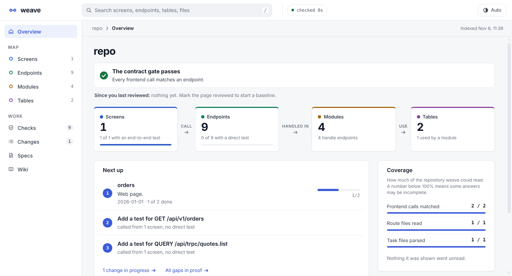
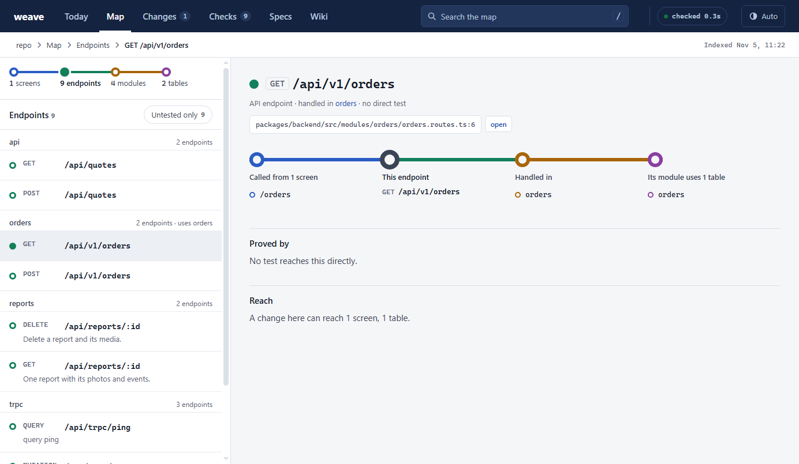
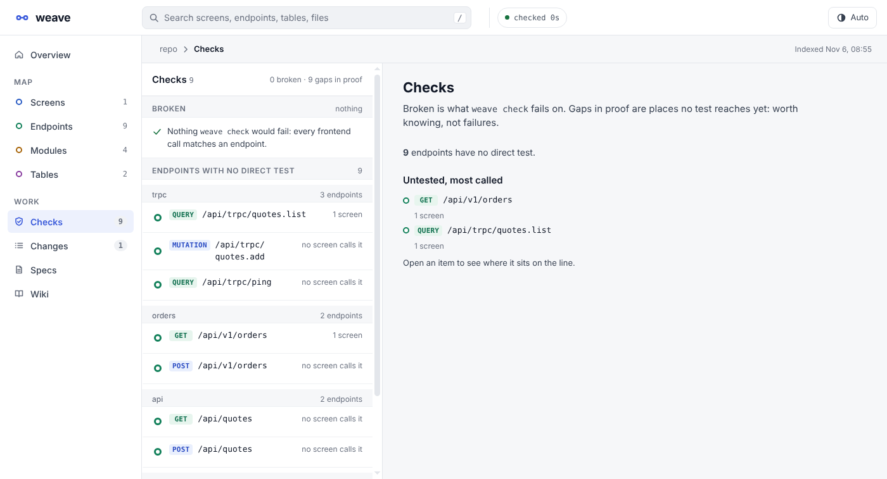
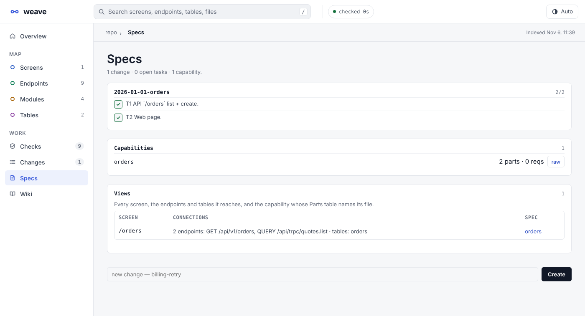
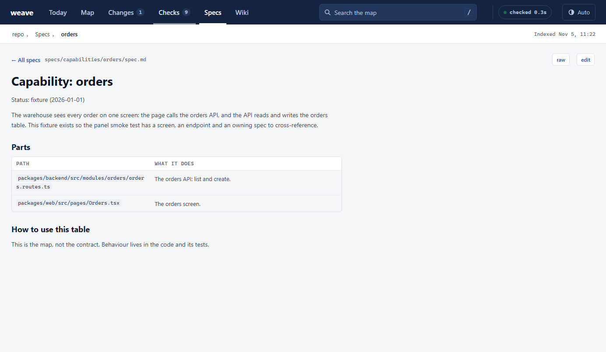
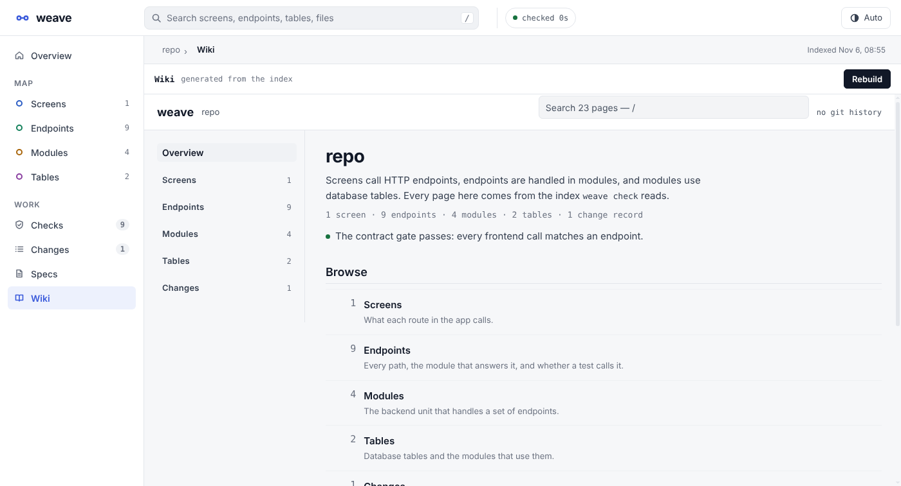

# weave

Your agent says it is done. This is how you check.


weave reads your repository once and draws it as four lines: **screens** call **endpoints**,
endpoints are handled in **modules**, modules use **tables**. Change records, tests and
requirements hang off that map. One static binary, nothing to run beside it.


- **A gate.** `weave check` exits 1 when a frontend call reaches an endpoint that no longer
  exists, and names the caller's `file:line`.
- **A panel.** `weave serve` hosts the map with the gate, file windows, notes and the change
  specs in it.
- **A wiki.** `weave wiki` writes a page per module, endpoint, screen, table and change, and
  tells you when the pages describe an older commit.
- **An agent interface.** `weave mcp` answers "what is this file, what does it touch, what
  proves it" in a few hundred tokens instead of a few thousand.

**Works with** Express, Fastify, NestJS, Next.js (app and pages router), Remix and React
Router v7 file routes, React Router `<Route>` tables, tRPC and OpenAPI JSON, with tables from
Prisma, Drizzle or TypeORM, across monorepo packages and tsconfig path aliases. Anything else
(GraphQL, your own fetch wrapper) takes a one-line regex in
[`.weave/patterns.json`](docs/REFERENCE.md#your-own-patterns), and `weave doctor` names every
file it could not read, so you know where the map ends.

Download a binary for macOS, Linux or Windows from
[Releases](https://github.com/michalbasisty/weave/releases), or build it:

```bash
go install github.com/michalbasisty/weave/cmd/weave@latest   # Go 1.22+ to build, nothing to run
cd /path/to/your/project
weave init --hooks    # connect Claude, Cursor, VS Code, opencode, and the Stop hook
weave serve           # http://127.0.0.1:7777: the map, hosted
weave check           # what a change breaks (exit 1)
```

## What you use it for

| You are... | Ask weave | You get |
|---|---|---|
| **Handing work to an agent and wondering if "done" is true** | `weave check`, or let the Stop hook run it | exit 1 and `file:line` when a call no longer matches an endpoint; exit 0 and silence otherwise |
| **About to edit a file** (or an agent is) | `context(files)` / `weave context <file>` | the screen, endpoints, tables, owning change, open tasks and the tests with the command to run them |
| **Planning what to build next** | the Overview page, `plan(slug)` | the next unfinished task, its files and its command; Changes shows done / total per record |
| **Reviewing what an agent changed** | Overview, "since the last commit" | what was added, removed or moved on the map, and which removed endpoints are still called |
| **Looking for gaps in proof** | Checks | every endpoint no test reaches, ranked by how many screens call it, kept apart from what is actually broken |
| **Keeping specs honest** | Specs, then Views | every screen with the endpoints and tables it reaches and the capability spec that owns its file |
| **Onboarding someone** | `weave wiki` | a browsable site, one page per thing, stamped with the commit it describes |
| **Wondering "what else breaks if I change this?"** | `impact(files)` | the complete blast radius, not a sample |

### Checking an agent's work


The gate runs at the end of an agent turn (Stop hook), before a commit, and in CI. Three
failures, no opinions:

- a **removed endpoint is still called**: it compares the endpoint set with the previous one;
- a **call site matches no endpoint**: a route that was renamed, or a typo;
- a **requirement's test fails**, when the code names the requirement and a JUnit report exists.

Everything else is a warning, because a gate that cries wolf gets switched off in a week.

### Reading the repository in ten seconds



*Overview* is the page to open first. The status line says whether the contract holds, the four
cards say how big the repository is and how much of it a test reaches, and "Next up" orders the
work: broken calls first, then the change in progress, then the biggest gaps. "Coverage" prints
what the extractors could read, so a zero is never a guess.

### Following one thing across the stack



Open any screen, endpoint, module or table and it is drawn on the line it sits on: who calls
it, who handles it, what it uses, which test proves it, and how far a change would reach.
Every neighbour is a link, and the handler's `file:line` has an **open** button that shows the
code beside the map and takes a note for the next session.

### Finding what nothing proves



*Checks* separates two things that look alike. **Broken** is what `weave check` fails on.
**Gaps in proof** are places no test reaches yet: worth knowing, not failures. The tab badge
counts the gaps so the place never reads as empty.

### Managing specs next to the code



*Specs* is a menu place that takes the full width:

- **Views** maps every screen to the endpoints and tables it reaches and to the capability
  whose Parts table names its file (the longest matching path wins);
- **Changes** lists each record in `specs/changes/` with a checkbox per task. A tick rewrites
  that one checkbox in `tasks.md`, and a change can be started from the same page;
- **Capabilities** lists every `specs/capabilities/<area>/spec.md`.



A capability opens as a page, not as raw Markdown: title, prose, the Parts table with its
paths in monospace. `raw` shows the source in the file window and `edit` saves the Markdown
(Ctrl+S) through a lock and a temp-file rename, so a reader never sees half a document.

### Giving everyone the same documentation



```bash
weave wiki                 # .weave/wiki: local, gitignored
weave wiki --out docs/wiki # a wiki you can commit and send
weave wiki --check         # exit 1 when the pages describe an older tree
```

A sidebar that mirrors the graph, one directory page per section, search on every page (`/`),
the handler's code next to the endpoint, the tests that prove it with the command to run them,
and prev/next at the foot. `llms.txt` lists the same pages for an assistant, one line each.
Every page is generated, so the documentation cannot drift into a document nobody trusts.

## What it costs, and what it saves


| | weave | the alternative | difference |
|---|---|---|---|
| a route question | **66 tokens** | found by hand: not findable with grep | `GET /api/v1/tasks/:id` is `/:id` under a mount in the source |
| a screen's whole context | **346 tokens** | 4,657 for the screen's file alone; 61,687 gathering the same facts | about **13x** less than the file, about **178x** less than by hand |
| install cost | **1,433 tokens** of MCP schema (14 tools) | GitHub 18,000, Notion 9,000, filesystem 3,500 | see the chart below |
| index a 954-file repo | **330 ms** | | one static binary |
| run the gate | **406 ms** | | quiet when it is right |


The cheapest thing about it is not the tokens. It is that the answer is *right*: a route that
grep cannot find is answered with the `file:line`, and a gate that names the broken caller
saves the next review round. The measurements, methods and the comparison with other tools
are in [`docs/COMPARISON.md`](docs/COMPARISON.md).

**What is not proven.** The numbers above are measured on weave's own answers. Whether having
them *changes an agent's behaviour* (fewer tokens per task, fewer wrong files, a higher pass
rate) has not been measured end to end. [`docs/EVAL.md`](docs/EVAL.md) is the protocol that
would; until it runs, other tools' reported savings are context, not a promise:


## The panel

`weave serve` binds `127.0.0.1` and keeps its write token in `.weave/serve.token`, so a restart
keeps the URLs people have open (`--new-token` rotates it). It serves one page with a sidebar:

| Place | Holds |
|---|---|
| **Overview** | gate verdict, a card per line, next up, coverage, what changed since the last commit |
| **Screens, Endpoints, Modules, Tables** | the map: every item, each drawn on its line |
| **Changes** | change records with their tasks |
| **Checks** | broken calls and gaps in proof |
| **Specs** | Views, change records, capability specs, spec editor |
| **Wiki** | the generated pages in place, with a Rebuild button |

**Check** and **File** share one dock beside the map, non-modal so the map stays usable: the
gate output with clickable `file:line`, and one file window with a note field that writes
through `weave remember`. Each surface keeps its content when you switch. It is a local tool,
not a team server: loopback only, one origin, no uploads.

## Agents

`weave init` writes MCP configs for Claude Code, Cursor, VS Code and opencode (`--only claude`
to pick). The server is
stdio, answers from one JSON index, writes only change records and their task checkboxes, and
every answer ends with the tokens it cost:

| tool | what it returns |
|---|---|
| **`context(files)`** | the pack to read before editing: page, endpoints with `file:line`, tables, owning change, open tasks, tests **and the command to run them**, in a 350-token budget |
| `impact(files)` | the complete blast radius |
| `search(query)` | endpoints, pages, modules, tables, requirements, tests by name; `text: true` scans source |
| `plan(slug)` | the next unfinished task of a change, with its files and command |
| `task_done(change, task)` | ticks one task in `tasks.md`, the same edit as `weave spec task done`; `task_reopen` undoes it |
| `change_new(name)` | creates `proposal.md`, `tasks.md` and `spec-delta.md`, as `weave spec new` |
| `change_delete(change, confirm)` | removes one change record; destructive, needs `confirm: true` |
| `changed(ref)` | what the graph gained or lost since a git ref |
| `verify(files?)` | the gate on the current diff: broken calls, untested endpoints, the owning change, and the commands to run; `strict: true` fails on an untested endpoint |
| `remember` / `recall` | a note beside the files it concerns, returned as a claim, never evidence |

`context` answers "I know the file, what is it?", `plan` answers "I know the spec, what
next?", `impact` answers "I know the change, what else breaks?". What agents actually call,
and what that says about the tool surface, is in [`docs/AGENTS.md`](docs/AGENTS.md).

## It says what it could not parse

Every extractor misses something, and a tool that misses a route silently gives a confident
wrong answer. So coverage is measured and printed (route files, client calls, task files,
Prisma models, tRPC routers) and any file that looks like a contract but produced nothing is
named. That list is the honest boundary of every answer weave gives.

```bash
weave doctor
```

## More

- [`docs/REFERENCE.md`](docs/REFERENCE.md): every command, every extractor, traceability, CI, known limits.
- [`docs/COMPARISON.md`](docs/COMPARISON.md): the charts and their methods.
- [`docs/PLAN.md`](docs/PLAN.md): where this is going, and the replay that says what not to build.
- [`docs/DESIGN.md`](docs/DESIGN.md): the research the product rests on.
- [`docs/explorer/DESIGN.md`](docs/explorer/DESIGN.md): the visual contract of the map.

## License

[MIT](LICENSE)
- [`test/ui/README.md`](test/ui/README.md): the browser smoke test, which also regenerates the
  screenshots here: `node test/ui/panel.mjs --out docs/img/screens`.

```bash
go test ./...    # unit, golden and integration suites
```
