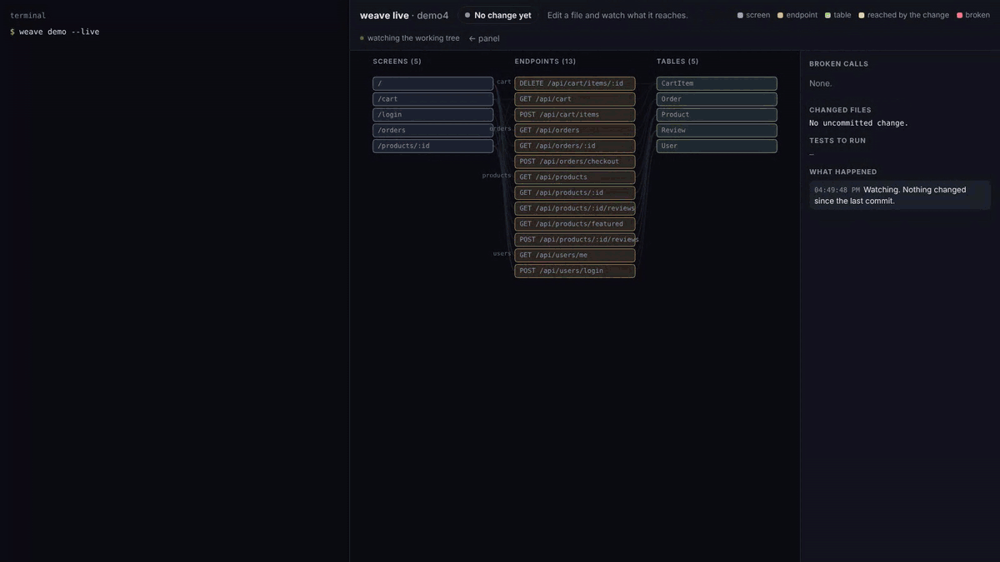
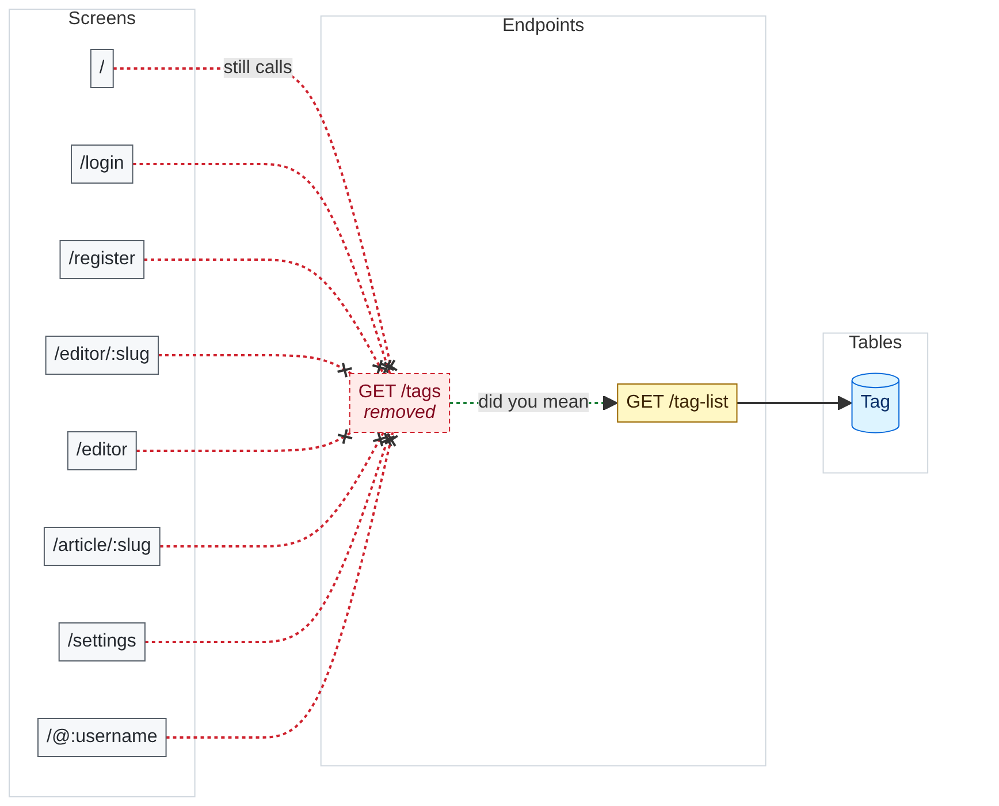
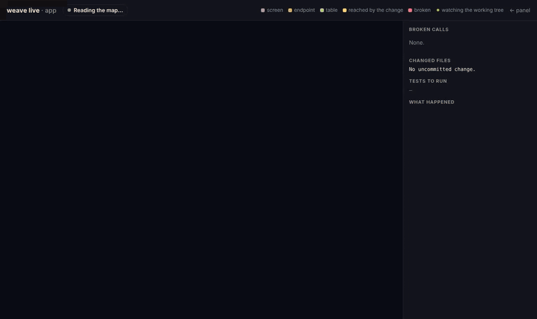

# weave

**Catch the frontend call your agent just broke, before it says "done".**

An agent renames a route. The server builds, the tests it touched pass, and it reports done.
The screen that called the old route is now broken, and nothing noticed, because a route and
its caller only share a string.

weave reads a web app's repository and maps it: which **screens** call which **endpoints**,
which **modules** handle them, which **tables** they touch. Then it holds every change to that
map. Rename a route, delete a tRPC procedure or drop a GraphQL field, and `weave check` fails
with the `file:line` that still calls it, the screens that lose their data, and the route it
most likely meant. It runs when the agent stops, before a commit, or on a pull request.

One static Go binary. No server, no account, no network.



## Try it in 30 seconds

```bash
go install github.com/michalbasisty/weave/cmd/weave@latest   # or grab a binary from Releases
weave demo --live
```

`weave demo` unpacks a small Express + React + Prisma shop into a temporary folder and maps
it. Then it renames `GET /api/orders` the way an agent would and runs the gate. The gate fails,
names the two screens that lost the route and the route they meant, then passes once the
client is fixed. With `--live` the map in your browser follows along: red when it breaks,
green when it's fixed. Nothing in your own code is touched.

Then on your app:

```bash
cd your-app
weave check          # what the uncommitted change breaks; exit 1 if anything
weave live           # the map in your browser, lit up by your change as you edit
weave init --hooks   # wire the gate into Claude Code, Cursor, VS Code, opencode, OpenChamber
```

Binaries for macOS, Linux and Windows are on
[Releases](https://github.com/michalbasisty/weave/releases).

## What it catches

Rename `GET /tags` to `/tag-list` in the RealWorld Express back end and leave the React front
end alone:

```console
$ weave check
check: 1 file(s) → 1 endpoint(s), 0 page(s), 1 test(s), 1 endpoint(s) removed
  FAIL removed endpoint still called: GET /tags from frontend/src/agent.js:218 (closest now: GET /tag-list)
  warn no spec change record names these files
  warn 1 touched endpoint(s) have no direct test
  run  cd backend && npx jest src/tests/services/tag.service.test.ts
```

Exit code 1, the caller's line, the route it most likely meant, and the tests to run. When a
change renames a route, "most likely meant" is the route that same change added, not just the
nearest name.

To test this, every route a front end calls was broken one at a time, three ways: renamed,
deleted, and given another HTTP method. That was done on ten apps: the RealWorld React front end
in front of six back ends (Express, Gin, Flask, Django, Rails, Laravel), and four real products
exactly as they are published ([Papermark](https://github.com/mfts/papermark),
[Linkwarden](https://github.com/linkwarden/linkwarden), [Outline](https://github.com/outline/outline)
and [Umami](https://github.com/umami-software/umami)).

**The gate failed and named the caller 661 times out of 675** (476 of 487 on the real
products). A blank line added to each route file, the harmless control, **failed the gate 0
times out of 265**.

When a call outlives its route but still matches another one (`/links/archive` falling onto
`/links/:id`, or `/auth/forgot-password` onto NextAuth's `[...nextauth]` catch-all), the gate
finds it by the path its file still spells. The 14 misses are a variable segment that still
has another value to go to (`/unsubscribe/${type}` with only `yir` gone), and a route declared
twice, where removing one copy breaks nothing.

Three things fail the gate, nothing else: a **removed endpoint that is still called**, a
**call that matches no endpoint**, and a **requirement whose test fails** (when you link
them). Untested endpoints and stale specs are warnings, because a gate that cries wolf gets
switched off in a week.


### On a pull request

The bundled GitHub Action posts the same report as a comment, with the screens that lose
their data:

> ### ❌ weave check: 1 problem(s)
>
> | endpoint | called from | screens | did you mean |
> |---|---|---|---|
> | `GET /tags` | `frontend/src/agent.js:218` | `/`, `/login`, `/register`, `/editor/:slug`, `/editor` +3 | `GET /tag-list` |

Under it is a diagram of the blast radius, which GitHub draws from the comment itself. It shows
every screen that still calls the removed route, the route it most likely meant, and the tables
behind it. A PR that breaks nothing gets the same picture of what it reaches, so a reviewer sees
which screens a back-end change touches before opening a single file.



```yaml
# .github/workflows/weave.yml
on: pull_request
permissions: { contents: read, pull-requests: write }
jobs:
  weave:
    runs-on: ubuntu-latest
    steps:
      - uses: actions/checkout@v4
        with: { fetch-depth: 0 }
      - uses: michalbasisty/weave@main
        with: { against: origin/main }
```

### While you edit

`weave live` (or the Live tab in the panel) draws the whole app in three columns,
screens → endpoints → tables, and lights up what your uncommitted change reaches while you or
an agent edit. A route that disappears while screens still call it turns red, with a dotted
line to the route it most likely meant, and goes green when the caller is fixed. It watches the
working tree, so there is nothing to click, and it keeps up on a 2,458-file monorepo.



## Why not grep and read the files?

In a modern stack the URL is often not written down anywhere. tRPC builds it from nested
router keys, Remix from file names, and NestJS from two decorators and a global prefix:


And when an agent needs to understand a screen before changing it, the facts are spread over
the screen, its handlers, their tests and the models behind them. weave answers with one
call:


```console
$ weave context frontend/src/components/Home/index.js
/  frontend/src/components/Home/index.js
used by   1 file(s)
page      /, /login~, /register~, /editor/:slug~ +4
module    auth, tag, article, profile
endpoint  GET /user  auth/auth.controller.ts:45
          POST /users/login  auth/auth.controller.ts:30
          POST /users  auth/auth.controller.ts:14
          PUT /user  auth/auth.controller.ts:61
          +11 more
tables    User, Tag, Article, Comment
run
  cd backend && npx jest src/tests/services/article.service.test.ts src/tests/services/auth.service.test.ts …
tests     none for this file; 5 in its modules
untested  GET /user, POST /users/login, POST /users +12
also      /login, /register, /editor/:slug, /editor share these endpoints
~         inferred link — a lead, not a fact
```

## Measured on real repositories

Rerun on 2026-11-13 against the current code:

| | [documenso](https://github.com/documenso/documenso) | RealWorld Express + React | [RealWorld NestJS](https://github.com/lujakob/nestjs-realworld-example-app) |
|---|---|---|---|
| stack | Remix, tRPC, Prisma monorepo | Express, Prisma, React, Redux | NestJS, TypeORM |
| screens / endpoints | 119 / 327 | 8 / 20 | — / 21 |
| frontend calls matched | **312 of 312** | **18 of 18** | — |
| screens linked to their endpoints | 87 of 119 | 8 of 8 | — |
| tables with a module that uses them | 55 of 55 | 4 of 4 | 5 of 5 |
| false failures on the unchanged repo | **0** | **0** | **0** |
| `weave check` | ~1.7 s | 71 ms | 38 ms |

The same React front end in front of Gin, Flask, Django, Rails and Laravel back ends matches
18 of 18 calls with 0 false failures on each ([details](docs/COMPARISON.md#6-python-go-ruby-and-php-back-ends)).

Four real products, cloned as they are:

| | [Papermark](https://github.com/mfts/papermark) | [Linkwarden](https://github.com/linkwarden/linkwarden) | [Outline](https://github.com/outline/outline) | [Umami](https://github.com/umami-software/umami) |
|---|---|---|---|---|
| stack | Next.js (pages and app router), Prisma | Next.js pages router, Prisma monorepo | Koa, Sequelize, React | Next.js app router, Prisma |
| files / endpoints | 1,434 / 374 | 718 / 74 | 2,549 / 250 | 1,696 / 207 |
| front-end calls matched | 124 of 130 | **46 of 46** | **79 of 79** | **23 of 23** |
| false failures on the unchanged repo | **0** | **0** | **0** | **0** |
| breaks caught (rename, delete, method) | 205 of 213 | 78 of 80 | **155 of 155** | 38 of 39 |
| `weave check` | ~1.0 s | ~0.5 s | ~1.7 s | ~0.6 s |

Papermark's unmatched calls go to four routes that the public repo does not have:
- `/api/teams/:teamId/billing/manage`, called from six components;
- `billing/retention-offer`;
- `/api/branding/auto-fill`;
- `/api/links/:id/revalidate`. They sit in the unchanged code, so the gate reports them in the
index and does not fail on them: it fails only on what a change breaks.

The first run on these four apps found six kinds of false alarm:
- `${team?.id}` was read as the start of a query string.
- `"/api/x/" + id` lost its last segment.
- `switch (req.method)` was not read as a list of methods.
- Next.js `[[...slug]]` routes were not matched.
- Koa routes without a leading slash were not read.
- A test's `server.post(...)` was counted as a route.

Each is fixed, and each has a test.

It is quick enough to run on every agent turn:


None of these needed any configuration. Every number comes from [`bench/run.mjs`](bench/run.mjs),
which fetches these repositories at fixed commits ([`bench/fetch.sh`](bench/fetch.sh)), so
anyone can rerun it. Methods and raw results are in [`docs/COMPARISON.md`](docs/COMPARISON.md).

## How it's tested

Every pull request runs all of this on Linux, macOS and Windows, and the gate checks itself
on a fixture app:

| suite | what it holds |
|---|---|
| 169 Go tests (`go test ./...`) | extractors for every supported stack, the graph, the gate, the PR comment and its diagram, the MCP server, the panel's API and the live map |
| a regression repo (`test/integration`) | every shape that once caused a false FAIL on a real repository, rebuilt as one small repo so the bug can't come back unnoticed |
| `weave demo` end to end | the sample shop must fail on the rename with the right screens and route, then pass after the fix |
| the panel in headless Chrome (`test/ui/panel.mjs`) | 25 checks: menus, specs, editing and saving a spec, the Check button, file links, the wiki |
| the OpenChamber extension (`node --test`) | 11 tests: downloading and verifying weave, the agent note, the @ menu, the gate after each agent turn, and the Specs tab end to end against a freshly built weave |
| the Action on `test/fixture` | the real `action.yml` runs against a small app on every pull request |
| the benchmark (`bench/`) | the numbers above on pinned commits of 12 public repos: 0 false failures on each unchanged repo, and 675 deliberate breaks (rename, delete, change method) on ten apps, 661 caught, with 265 harmless edits as the control |

The agent itself was measured too. Over 72 Claude Code sessions on two repos, with and
without weave ([`docs/EVAL.md`](docs/EVAL.md#second-round-72-sessions)), the tasks succeeded
equally often (36 of 36 each). That is why weave is pitched as a gate, not as a token saver:
see [What it does not do](#what-it-does-not-do).

## Four ways in, one index

**The gate.** `weave check` when the agent stops (`weave init --hooks` writes the
[Claude Code Stop hook](docs/REFERENCE.md#connecting-an-agent) and an opencode plugin that
OpenChamber runs too), in a pre-commit hook, or in CI with the Action above.

**The panel.** `weave serve` hosts the map on `127.0.0.1`: an overview with the gate's
verdict, every screen, endpoint, module and table, the checks, your specs, the live map and a
generated wiki. A dropdown switches between every repo weave has indexed. Every `file:line`
opens in VS Code or Cursor. Light and dark follow your system.

<picture>
  <source media="(prefers-color-scheme: dark)" srcset="docs/img/screens/documenso-dark.png">
  
</picture>

<sub>documenso, a 2,458-file Remix + tRPC + Prisma monorepo, read with no configuration in about a second.</sub>

**The agent interface.** `weave mcp` gives Claude Code, Cursor, VS Code or opencode five tools,
plus the spec tools in a repo that keeps change records. The one that pays for itself is
`impact`: which screens and callers reach an endpoint, in one call instead of a chain of
searches. On "which screens show the inbox count?" in documenso it cut the agent's tokens by
43% and its cost in half. For a one-file edit the agent finds with one grep, any extra call
costs more than it saves ([the eval](docs/EVAL.md)), so `weave init` tells agents exactly
that in `CLAUDE.md` and `AGENTS.md`. The whole schema costs every session 708 tokens:


**The wiki.** `weave wiki` writes a page per screen, endpoint, module and table, stamped with
the commit it describes; `weave wiki --check` fails when the pages are stale.

## Works with

| | |
|---|---|
| **Back ends** | Express, Koa (`@koa/router`), Fastify, NestJS, Next.js route handlers (app and pages), Remix / React Router v7 resource routes, tRPC (routers across files), GraphQL (SDL, NestJS resolvers, Pothos, Nexus), OpenAPI JSON |
| **Python, Go, Ruby and PHP back ends** | FastAPI, Flask, Django and Django REST framework; gin, echo, chi, gorilla and net/http; Rails and Laravel routes. The RealWorld React front end matches 18 of 18 calls against each of the Gin, Flask, Django, Rails and Laravel back ends |
| **Front ends** | React Router `<Route>` tables (lazy imports too), Next.js and Remix file routes; `fetch`, axios and any HTTP-like client, tRPC hooks, `gql` documents |
| **Data** | Prisma, Drizzle, TypeORM, SQLAlchemy, Django models, GORM |
| **Agents** | Claude Code, Cursor, VS Code / Copilot, opencode (MCP config, instructions, gate hook), and OpenChamber, which also gets a self-contained [extension](extensions/openchamber/) (it fetches weave itself): a map panel, the gate on your change and after each agent turn, and @weave in the composer |
| **Monorepos** | workspace package names (`@acme/lib/…`) and tsconfig `paths` (`~/…`) |
| **Anything else** | a one-line regex in [`.weave/patterns.json`](docs/REFERENCE.md#your-own-patterns) |

weave says what it could not read. `weave doctor` and the panel's Coverage card list every
file that looked like a contract but produced nothing, so you know where the map ends instead
of trusting a confident wrong answer.

## What it does not do

- It reads source, it does not run it. A URL assembled at runtime from configuration is
  reported as unknowable, not guessed.
- It links screens to endpoints per file. A screen that imports a shared API client is linked
  to every endpoint that client calls, so it can over-report screens; it never under-reports
  a caller.
- Front ends are JavaScript and TypeScript; back ends are JavaScript, TypeScript, Python, Go,
  Rails and Laravel. Java and .NET back ends are not read yet, and neither are ActiveRecord or
  Eloquent models.
- It does not save an agent tokens on ordinary edits. Over 72 measured sessions, the weave arm
  used more tokens on rule changes and renames: the agent called weave and then read the same
  files anyway. It saved on one impact question and lost on another. The gate is the part that
  does not depend on the agent at all.

## More

- [`docs/REFERENCE.md`](docs/REFERENCE.md): every command and flag, every extractor, specs and traceability, CI, known limits.
- [`docs/COMPARISON.md`](docs/COMPARISON.md): how each chart was measured, and the raw numbers.
- [`docs/EVAL.md`](docs/EVAL.md): the agent sessions, with and without weave.
- [`docs/AGENTS.md`](docs/AGENTS.md): what agents actually call, from a month of logs.

```bash
go test ./...                                             # Go suites, including the demo
node test/ui/panel.mjs                                    # the panel in headless Chrome
node --test extensions/openchamber/service/main.test.mjs  # the OpenChamber extension
bench/fetch.sh && node bench/run.mjs && node bench/charts.mjs   # the benchmark
```

## License

[MIT](LICENSE)
