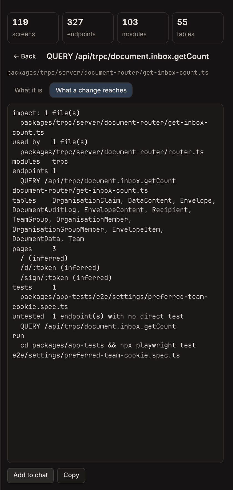
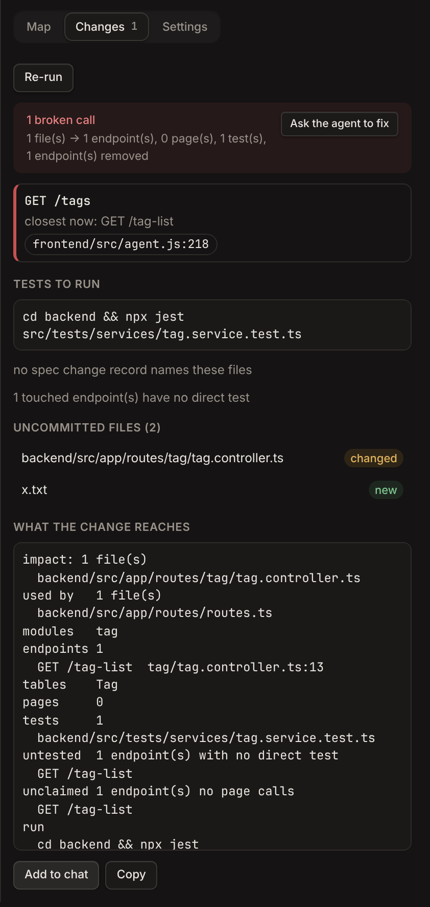
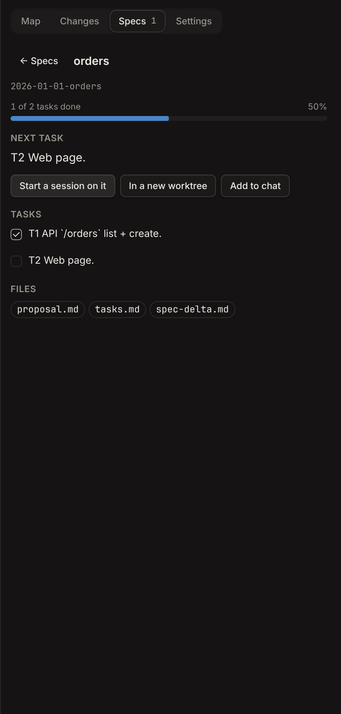

# weave for OpenChamber

[weave](https://github.com/michalbasisty/weave) inside OpenChamber, with nothing else to
install. Add the extension, allow its local service, and open a web app project.

- **A panel** in the side rail with the project's map: screens, endpoints, modules and tables,
  a search box that takes plain words ("inbox count"), and a page for each item that links to
  its neighbours and shows what a change to it reaches.
- **Changes**: your uncommitted change, checked by weave's contract gate. Each front-end call it
  broke is listed with the route it most likely meant, along with the tests to run and an
  **Ask the agent to fix** button.
- **Specs**: the project's change records under `specs/changes/`, each with a progress bar.
  Open one to tick its tasks (weave records the files that prove each one), read or edit its
  proposal, tasks and spec delta, and hand the next task to an agent: **Start a session on it**
  opens a new session (or one in a new worktree) with the task, its plan and the files it
  touches. **New change** creates a record. Capability specs are listed and open the same way.
- **The agent knows weave is there.** Every session gets a short note on when to call it, and
  after each agent turn that changed the code, the gate runs. If the turn broke a call, that
  session is told what broke, once per failure.
- **@ in the composer**: the "weave map" rows add a screen, endpoint or table to your message,
  together with its impact. Type `spec` (or a change's name) to add a change's next task with
  its plan.
- **Work Status** has a "weave gate" section with the same verdict, and a progress bar for
  each open change record.
- In the Files view, **weave: what a change reaches** on a file opens its impact.

## Install

In OpenChamber, open **Settings → Extensions** and add
`https://github.com/michalbasisty/weave-openchamber` (or this folder, or the
`weave-openchamber.zip` from a [release](https://github.com/michalbasisty/weave/releases)).
Approve it. That is all.

The first time the service starts, it fetches weave for your machine from the latest release
and checks the file against that release's `checksums.txt`. The copy lives in the extension's
data folder, and the service checks for a newer release once a day. A weave 0.8.0 or newer (0.10.0 for capability specs and rendered spec pages)
on your `PATH` (or in `~/go/bin`, `~/.local/bin`, `/opt/homebrew/bin` or `/usr/local/bin`) is
used instead, and then nothing is downloaded. **Settings** in the panel shows which weave runs.

What you approve:

- **The local service.** It runs `weave` and `git` on the project you have open and downloads
  weave from github.com. It has no dependencies.
- **Instructions.** The note that tells agents about weave. Turn it off in the panel's
  Settings.
- **Session control.** This lets the service send a session the gate's failures after a turn.
  Turn it off with **Check each agent turn** in the panel's Settings.

## Files

- `package.json`: the manifest. It declares the rail panel, the Work Status section, the
  Files-view action, the @ menu rows, the agent note, the session events (`turn-started`,
  `turn-finished`) and the local service, which keeps running.
- `service/main.js`: the service. Plain Node, no packages.
  - `GET /status` serves the Work Status section.
  - `/overview`, `/node`, `/search`, `/context`, `/impact`, `/changes` and `/about` serve
    the panel, and `POST /settings` and `/update` change it.
  - `/specs`, `/spec` and `/plan` serve the Specs tab, and `POST /spec/save`, `/spec/new`
    and `/spec/task` change spec files.
  - `/mentions/search` and `/mentions/resolve` serve the @ menu.
  - `/session-events` receives the turn events.

  `service/main.test.mjs` tests it (`node --test extensions/openchamber/service/main.test.mjs`).
- `panel/main.ts`: the panel's source. `panel/main.js` is its bundle, built with
  `bun node_modules/@openchamber/sdk/scripts/bundle-guest.ts panel/main.ts panel/main.js`.

It needs OpenChamber 2.7.0 or newer. Checked with `openchamber-guest-check` from
`@openchamber/sdk` 2.7.0.
